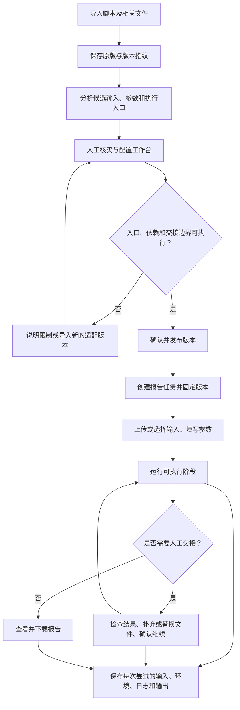
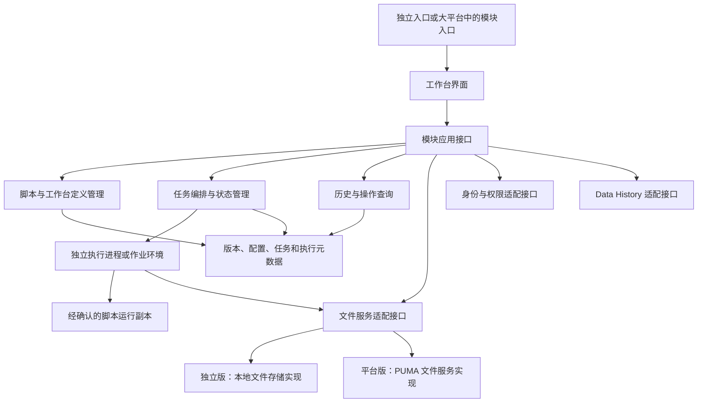
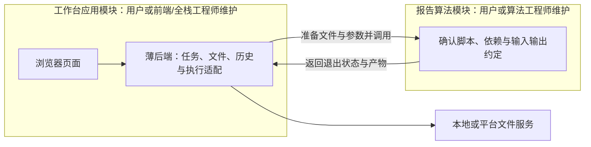

> 目的：定义 PyReport Workbench 的产品行为、集成边界和验收要求，供用户借助 Codex 分阶段开发。　目标读者：独立开发本模块的用户、协作 AI 工具及后续平台集成人员。　如何阅读：先读第 1–4 节理解范围与步骤规则，再按第 5–10 节评审页面和逻辑，最后核对验收与待确认事项。

# 02 PyReport Workbench 软件需求说明书

版本：0.1，需求与架构评审稿。日期：2026-11-07。

独立版技术基线已确定为原生 HTML/CSS/JavaScript + Python/Flask/Waitress + SQLite；公司环境版本、基础验证结果与待补信息见 [01 开发环境记录](01_DEVELOPMENT_ENVIRONMENT.md)。该环境记录不代表本项目业务功能已实现或验收。

本文根据本次用户要求和引用聊天中可读取的最近五轮重新整理，未取得原聊天所链接需求说明书的正文。用户已确认步骤划分原则与“先需求和计划、后编码”的顺序，并要求支持前端与算法人员分工维护。本文其余具体设计为评审方案，重要未决项列在第 12 节。

## 1. 前言与目标

目标用户是为新加坡银行编制监管报告的风险管理人员。用户导入平时用于处理数据和生成报告的 Python 脚本，系统帮助其建立可重复使用的操作工作台。运行人员通过准备文件、填写参数、执行、检查结果及下载报告完成工作，不必每次手工操作代码。

本模块先独立开发，再嵌入现有大平台。引用讨论中大平台称为 PUMA，另有 CRS Data History 集成方向；具体接口尚未知。本说明书不定义或认定任何 MAS 计算规则。报告计算逻辑由用户确认的脚本承担，其正确性需由业务基准验证。

区分两个对象：**工作台定义**描述如何运行一类报告；**报告任务**代表某实体、某期间的一次业务工作，并可包含多次执行尝试。

## 2. 范围与设计原则

| 编号 | 需求 |
|------|------|
| R01 | 导入并保存脚本原版，以版本管理；分析候选输入、输出、参数、依赖与运行入口，允许人工修正确认。 |
| R02 | 发布经确认的工作台定义，运行任务固定使用其脚本版本与配置快照。 |
| R03 | 按用户操作的依赖边界分步骤；连续自动计算合并，不把每个函数或中间变量变成用户步骤。 |
| R04 | 直接运行选定、经确认的脚本，执行适配层负责准备条件与收集结果，不重新实现报告计算。 |
| R05 | 原版、适配版本和新版本有明确关系；代码差异可见，实际执行文件必须与所选确认版本一致。 |
| R06 | 支持输入文件、参数、执行状态、错误、输出下载和人工交接；人工替换及重跑保留来源与历史。 |
| R07 | 分别记录操作事件和报告执行历史，能够回答谁做了什么、报告使用了什么以及结果来自哪次运行。 |
| R08 | 独立版与平台版通过适配边界复用同一业务流程；上传下载对接平台文件服务。 |
| R09 | 支持工作台与报告算法分工维护；后端能力的归属采用简单方案，不为人员分工强制拆成多个服务。 |

首版建议围绕一套受控的样例脚本及虚构数据打通闭环。任意 Python 自动转换、自动改写计算代码、自动认定监管合规、平台真实对接和定时批量调度不纳入最小版本。

## 3. 总体设计

### 3.1 从脚本到报告的总体流程



### 3.2 逻辑架构与部署边界（建议）



建议将本功能按工作台应用、报告算法两个维护边界组织，初期作为一个整体部署；内部仍有浏览器、服务端和脚本执行环境。无需为分工拆成多个独立业务服务。图中执行环境是职责边界，具体使用何种进程或容器方案尚待确认。

文件内容由文件服务保管；模块保存文件标识、版本、校验值及业务关联。独立版可以在本地实现同一文件服务契约，避免迁移时重写任务逻辑。

### 3.3 数据流


上传完成不代表已被任务采用；任务必须明确绑定具体文件版本。脚本退出也不单独代表步骤成功，必需输出须存在且已保存，相关元数据写入完成。若输出保存失败，应保留计算结果与错误，允许重试保存，避免无故重算。

### 3.4 菜单与主要页面（建议）

| 一级菜单 | 页面或视图 | 目的 |
|----------|------------|------|
| 脚本与工作台配置 | 定义列表、导入配置详情；详情含脚本版本和代码对比视图。 | 建立可复用的报告运行方式。 |
| 报告工作台 | 任务列表、任务详情；详情内含步骤及 Data History。 | 日常报告生成与结果追溯。 |
| Operation Log | 操作查询页。 | 查询操作事件、人员、时间与关联任务。 |

Data History 首先作为任务详情中的视图，避免与 Operation Log 混为同一类记录；跨任务独立查询是否必要，待用户评审。

### 3.5 代码职责结构（逻辑地图，非已创建目录）

```text
界面                 配置、任务、差异、历史及操作查询
应用服务             版本发布、任务创建、执行请求与结果查询
领域模型             定义版本、任务、阶段、尝试、文件绑定与人工交接
脚本分析             静态分析建议、识别依据、未解析项与人工确认
执行适配             准备目录、参数映射、校验、启动、取消与收集
外部适配             文件服务、身份权限、Data History
元数据持久层         定义及运行记录；独立版使用 SQLite
验证样例             虚构输入、受控脚本、基准输出和验收场景
```

模块业务逻辑不直接依赖 PUMA 的文件路径或前端全局变量。技术基线见本文开头的环境记录链接；实际代码目录结构在架构确认后确定。

### 3.6 两个维护模块与工程师分工（新增评审方案）

用户希望前端与报告算法可分别维护，同时尽量减少人员和架构复杂度。建议用以下两个模块承接这一目标：

| 维护模块 | 内容 | 建议负责人 |
|----------|------|------------|
| 工作台应用模块 | 页面、应用接口、版本和配置管理、任务编排、文件服务对接、历史记录及脚本执行适配。包含前端与薄后端。 | 用户自己或能承担这些服务端职责的前端/全栈工程师。 |
| 报告算法模块 | 用户确认的 Python 脚本、依赖声明、运行入口与输入输出约定、算法验证用例及业务基准。 | 用户自己或算法开发工程师。 |

这里的“两模块”是代码与维护责任边界，不等于系统只有浏览器和算法两个技术层，也不要求配两位专职工程师。

**需要后端能力，但不必单独配后端工程师。** 后端必须处理浏览器之外的 Python 启动、作业状态、文件访问权限、运行记录及环境管理。熟悉页面开发但不具备这些能力的前端人员，不能仅凭岗位名称默认承担全部工作；可以由用户自己、具备全栈能力的工程师，或后续平台提供相应支持。

**薄后端属于工作台模块。** 它只组织运行，不实现报告计算公式。算法模块不能依赖页面状态、平台会话或前端组件，也不承担通用任务管理。双方通过确认的输入文件、参数、入口和输出约定协作。

建议维护边界示意：



建议初期统一部署，脚本在受控执行环境运行，不必另建算法 HTTP 服务。后续如果平台提供可复用的任务、权限或执行能力，可替换相应适配；在核实前不假设平台已经具备。

算法改动产生新脚本版本；页面改动无需改算法；输入输出契约变化则需要双方联调。若需要修改业务计算规则，应在算法模块形成可核对的新版本，不能在薄后端补写一套算法。

## 4. 步骤划分与原脚本一致性

### 4.1 已确认的规则

步骤的目的在于呈现用户需要采取行动的节点。只有后续需要消费前序结果，且存在用户补充文件、替换结果或确认继续等交接，才形成新的用户步骤。连续自动计算即使内部有数据依赖，也合并运行；可在日志展示内部处理信息。

无依赖的处理可合并呈现，但这不授权系统改变原脚本的顺序、并发执行或重排副作用。合并界面步骤与改变执行逻辑是两回事。

示例：阶段 A 生成中间文件，用户审阅后可上传替换文件，阶段 B 读取已确认版本生成报告。用户看到的操作可为“准备输入 → 运行并审阅 → 确认继续并生成报告”。实际阶段名称和数量随脚本配置确定，不固定为三个。

### 4.2 用户步骤与执行阶段的关系

一个用户步骤可以调用多个现成脚本入口。执行阶段表示一个真实可启动、结束并收集输出的运行单元；用户步骤表示一次集中操作或交接。界面不要求把所有执行单元各列成一个步骤。

配置应明确每个用户步骤包含的执行入口、前置结果、输入映射、输出要求与继续条件。文件依赖关系用于校验可运行性，不用于自动制造大量步骤。

### 4.3 不可绕过的脚本边界

- 脚本已有独立入口或可配置阶段：按其现有能力配置运行和交接。
- 单个脚本从头运行到结束且没有暂停入口：默认作为一个整体运行，只在前后提供操作；不得按文本行、任意函数或内存变量切片执行。
- 业务确需在脚本内部暂停：需先评估是否可通过原有参数和入口实现；否则导入新的适配版本，保留原版、对比差异、确认并验证后再用。
- 原脚本写死路径、要求手改变量或依赖交互式输入：显示不兼容原因，不宣称“自动导入成功”；先确定可复现的适配方式。

### 4.4 分析与发布校验

导入分析不执行用户脚本。显示每项分析的文件及位置依据，并标记无法解析的动态路径、动态导入、外部连接及不明确入口；用户可以补充配置。静态分析无法证明任意 Python 的所有输入输出与运行行为。

发布前至少核实：脚本版本已确认、所有入口存在、前置条件无环、必需输入有来源、人工交接有明确条件、参数有类型和必填规则、输出收集方式明确。未解析的必需信息必须补齐或明确限制后才能发布。

## 5. 脚本导入、配置与版本页面

| 区域 | 内容与操作 |
|------|------------|
| 基本信息 | 报告类型、名称、说明、版本备注；实体和期间字段是否必需按报告定义配置。 |
| 脚本文件 | 导入文件列表、入口、版本、校验值和兼容性问题；查看已保存原版。 |
| 分析结果 | 候选输入、输出、参数与依赖；显示依据、未确认项和用户修正。 |
| 步骤配置 | 合并连续自动处理；配置交接、执行入口与文件映射，预览最终用户步骤。 |
| 运行条件 | 目标 Python 环境、依赖说明、允许的外部依赖、资源和超时配置；具体可配置范围待定。 |
| 版本与差异 | 原版与实际执行副本对比、新旧版本对比；显示新增、删除、修改文件及来源。 |
| 发布检查 | 显示缺失项、不可执行边界及确认摘要；通过后发布定义版本。 |

建议定义版本状态为“草稿 → 待确认 → 已发布 → 已归档”。归档不删除已运行任务的引用。已发布定义不原地修改，变更生成新版本；运行任务不自动升级。

必须区分脚本版本与工作台定义版本：同一脚本的步骤、参数映射或输出配置变更，也需要新的定义版本，才能复现旧任务。

## 6. 报告工作台页面与交互

### 6.1 任务列表

展示任务标识、报告类型、实体、期间、定义版本、状态、创建人和更新时间，支持按适用字段筛选。创建时选择已发布定义，确认参数与文件需求；旧任务只能使用其固定版本，新定义不静默替换旧任务。

### 6.2 任务详情的布局

```text
任务摘要：报告、期间、实体、脚本/定义版本、总体状态
步骤导航：准备 → 当前操作阶段 → 后续阶段（按定义动态生成）
当前步骤：所需输入、参数、前序结果、检查提示
执行区域：运行状态、日志、开始/结束时间、失败原因
结果区域：文件、来源尝试、下载、人工替换及确认继续
历史区域：各次执行、输入输出关系、人工交接及环境信息
```

主要操作为“运行”“取消”“重试/重跑”“下载”“上传替换文件”“确认并继续”；各操作仅在符合状态和权限时可用。界面显示不能操作的具体原因，例如“缺少已确认的阶段 A 输出”。

### 6.3 用户操作流程

1. 选择已发布的工作台定义，创建报告任务并填写适用期间、实体与参数。
2. 上传文件或从可访问文件中选择输入，核对文件版本与检查结果。
3. 提交运行；系统固定该次输入、参数、脚本及定义版本，返回可查询的执行状态。
4. 查看运行结果。存在交接时，下载审阅，保留生成文件或上传替换文件，并明确确认下一阶段使用哪一份。
5. 满足前置条件后继续执行；失败时查看错误并选择适用的重试方式。
6. 下载最终报告，在 Data History 核对其运行来源。刷新或重新进入页面仍能恢复服务端状态。

### 6.4 文件检查和人工替换

输入首先校验必需文件、可访问性、版本及定义声明的格式或字段。检查范围由配置和具体解析器决定，不将“扩展名正确”显示为“业务数据正确”。预览不支持的文件提供下载与状态说明。

替换中间结果必须创建新的文件记录，保留原结果，记录操作人、时间、说明及绑定关系。仅上传不自动继续。确认后，后续尝试固定使用该文件版本；运行中的尝试不得被替换文件追改。

若下游已运行，再改上游输入或交接结果，应将受影响的下游结果标记为“不再对应当前输入”，阻止其作为当前有效报告使用。历史记录仍可查询，后续需明确重跑相关阶段。

## 7. 执行逻辑、失败与重跑

### 7.1 一次执行尝试

每次运行创建唯一尝试标识，记录提交人及固定快照；检查前置结果、文件权限、脚本指纹和环境是否就绪，再准备独立任务目录并启动确认脚本。收集退出状态、标准输出、错误及产物，在必需产物保存完成后标记成功。

参数优先通过脚本支持的命令行、配置文件、环境变量或工作目录传入；不在运行时自动替换源代码中的业务常量。采用何种方式必须随定义记录，适配文件若影响执行行为也须纳入版本与校验。

### 7.2 状态模型（评审方案）

| 对象 | 状态及含义 |
|------|------------|
| 用户步骤 | 未就绪、可运行、执行中、等待人工交接、已完成、失败、已取消、结果需重跑。 |
| 执行尝试 | 已提交、准备中、运行中、保存产物中、成功、失败、取消中、已取消；失联时显示待核实，不假定成功或安全重试。 |
| 报告任务 | 根据当前定义、阶段与交接状态汇总；所有必需阶段和交接完成且结果有效，才显示完成。 |

运行成功不等于人工交接完成。脚本成功后，如该步骤要求人工确认，用户步骤进入“等待人工交接”。尝试失败不删除旧成功尝试，但界面必须区分历史成功与当前有效结果。

### 7.3 核心约束

- 对同一任务阶段重复提交应防止重复启动；前端按钮禁用不代替服务端并发控制。
- 默认禁止同一任务中互相依赖的阶段同时运行。独立阶段合并展示时仍保持确认的执行顺序。
- 重新运行创建新尝试，不覆盖日志、输入或输出；后续阶段绑定具体上游尝试和文件版本，不能模糊读取“最新文件”。
- 上游重跑后，下游不自动继承旧成功结果；只影响当前任务的后继阶段，不修改其他任务的历史快照。
- 取消请求先进入“取消中”，确认进程结束后再显示“已取消”；部分产物不作为成功结果。
- 超时、服务重启或执行进程失联需保留上下文并核实状态；自动重试不得盲目重复外部写入。
- 计算成功而文件服务失败时，区分保存失败与计算失败；在允许的情况下只重试保存。
- 外部数据库写入、网络调用等副作用需在运行方案中声明；不能通过重跑按钮默认保证幂等。

### 7.4 运行保护

导入与分析不自动运行未知代码。执行环境与 Web 服务分离，脚本只获得声明需要的输入、输出目录和权限；避免继承平台凭据。生产隔离、资源限制、超时取消和网络访问策略在真实脚本执行前确定。

本地子进程只实现进程分离，不能单独称为安全沙箱。若早期版本只支持本机受控样例，界面和文档必须说明适用范围，不能据此开放任意脚本执行。

## 8. 历史记录、数据模型与一致性

### 8.1 概念对象

| 对象 | 关键内容 |
|------|----------|
| ScriptPackageVersion | 原版文件清单、版本、逐文件指纹、来源、确认记录；适配版本关联原版。 |
| WorkbenchDefinitionVersion | 引用的脚本版本、用户步骤、执行入口、输入输出及参数配置、发布记录。 |
| ReportTask | 报告业务标识、期间/实体等适用参数、固定定义版本、当前阶段与状态。 |
| ExecutionAttempt | 尝试标识、阶段、输入绑定、参数快照、代码指纹、环境、时间、退出结果与日志。 |
| ArtifactReference | 文件服务标识、版本或不可变引用、文件名、大小、指纹、来源与保存状态。 |
| HandoffRecord | 交接人、时间、生成结果、替换结果、确认使用的文件版本及说明。 |
| OperationEvent | 操作主体、动作、时间、对象、结果及关联任务/尝试。 |

以上是概念模型；独立版使用 SQLite，具体字段实现与后续平台数据库要求待确认。不存在版本能力的文件服务须由模块补足不可变快照或等效控制，不能仅以可覆盖路径承担追溯。

### 8.2 Data History 与 Operation Log

Data History 回答“这份报告怎么生成”：每次尝试的脚本及定义版本、输入文件、参数、环境、上游来源、输出、状态和交接。选择旧尝试时，展示其当时的数据，不显示当前替换后的文件冒充旧输入。

Operation Log 回答“谁在何时做了什么”：导入、配置、发布、创建任务、上传、运行、取消、替换、确认和下载等事件。日志保存必要的关联信息，不直接嵌入完整敏感数据或凭据。具体留存、导出与访问规则由后续平台要求确认。

### 8.3 结果一致性验收

分别验证代码、运行条件和结果：实际执行内容与确认版本一致；环境、输入、参数及顺序有记录；工作台输出与用户基准比较。Excel 等格式的比较需明确 sheet、行列、单元格值、公式、格式和数值误差要求。文件二进制不同可能来自生成时间等元数据，比较标准不能只凭文件 Hash 决定业务结果是否一致。

具体业务基准应由用户提供。虚构样例只验证软件行为，单组业务基准通过也不证明所有情况完全一致。

## 9. 文件服务与平台集成契约（待对接）

| 能力 | 模块需要的行为 | 尚需平台确认 |
|------|----------------|----------------|
| 上传与登记 | 取得稳定文件引用及保存结果，失败可识别；明确上传人和归属。 | 直传或代理上传、大小限制、接口与鉴权。 |
| 选择与读取 | 仅访问有权限的文件，绑定具体版本，运行时取得可验证内容。 | 文件查询、版本能力、下载方式与权限传递。 |
| 产物保存 | 保存每次尝试的独立输出，返回引用，失败不伪报成功。 | 覆盖策略、幂等键、重试与持久性保证。 |
| 下载 | 取得当前用户有权下载的文件；下载事件可关联任务。 | 临时地址、代理下载、有效期与审计回执。 |
| 身份与权限 | 获得可信主体，对查看、配置发布、运行、替换及下载分别校验。 | 平台会话、权限模型、实体范围、是否需复核角色。 |
| CRS Data History | 输出可关联的任务、尝试和文件来源；同步失败可追踪。 | 谁是记录主源、推送或拉取、字段及同步去重。 |

独立版拟提供本地文件适配与开发身份。开发身份不能作为生产权限机制。迁移时先明确元数据及文件标识迁移方式，不能只替换下载 URL 就认定迁移完成。

## 10. 非功能要求与验收证据

- 可追溯：每个当前报告能定位到固定脚本、定义、输入、参数和尝试，历史不被重跑覆盖。
- 可恢复：页面刷新不丢状态；服务重启后可以核实未完成作业，避免重复执行或遗漏产物。
- 可理解：错误区分配置、输入、脚本、环境、文件服务与交接问题，提供用户可采取的下一动作。
- 权限：校验对象级访问；后端不信任客户端传入的文件路径、用户身份和完成状态。
- 可迁移：本地与平台适配使用一致的业务契约，通过相同关键场景验证。
- 性能：文件大小、任务耗时、并发量及历史查询规模待代表性脚本与部署条件确定，不虚设已满足的指标。

## 11. 核心验收场景

| 场景 | 预期结果 |
|------|----------|
| 连续自动计算 | 读取、清洗、计算、导出不会仅因内部变量依赖被拆成多个用户步骤。 |
| 必需人工交接 | 前阶段完成后等待审阅或补充文件，未确认不能启动依赖阶段。 |
| 无中途入口的单脚本 | 作为整体运行，或明确提示需要适配；不悄悄切割执行。 |
| 分析不完整 | 未确认的必需输入/入口阻止发布；页面可补充并显示分析依据。 |
| 原版保护与差异 | 新版不覆盖旧版；执行文件与确认版本不符则停止并显示原因。 |
| 固定任务版本 | 发布新版后，旧任务的脚本、定义及历史引用保持不变。 |
| 完整运行 | 虚构输入经确认脚本产生预期输出，文件保存完成后才显示成功并允许下载。 |
| 人工替换 | 原结果及替换结果均保留，后续绑定已确认文件，可追溯是谁选择。 |
| 上游变化与重跑 | 新尝试保留旧记录，受影响下游被标记需重跑，旧结果不冒充当前有效报告。 |
| 重复点击与恢复 | 同次请求不重复启动；刷新页面可查询到真实状态。 |
| 失败与取消 | 脚本失败、超时和取消不显示成功；部分产物标明不完整。 |
| 文件服务失败 | 计算与保存状态区分；保存重试不导致未经确认的重复计算。 |
| 历史与操作事件 | 报告能还原运行来源，操作日志能关联人、任务和尝试。 |
| 基准验证 | 在约定输入、环境和比较标准下，与用户原运行输出比较并保存差异。 |
| 平台适配 | 授权上传下载、权限拒绝、失效链接与接口失败场景可识别并可追踪。 |

这些是后续实现的验收要求，目前没有应用实现或测试通过记录。

## 12. 开始编码前的待确认事项

1. 审阅“工作台应用含薄后端＋报告算法”的两模块方案、菜单、版本/重跑与人工交接规则，以及首版必做范围。用户已提出分工需求，薄后端归属方案尚待确认。
2. 第一套代表性脚本及其原运行环境；首版支持单 `.py`、脚本包还是 notebook。建议先用一套普通 Python 样例闭环，扩展支持另行规划。
3. 在已确定的技术基线上补全公司 Python 版本与依赖清单，确认运行隔离、具体存储结构及后续平台部署条件。
4. 用户基准、文件比较标准、业务性能规模与是否需审批复核。
5. 如需严格复用旧页面设计，补充原说明书正文；平台接口资料可在进入集成阶段前补齐。

分阶段交付和各阶段完成标准见 [03 项目开发计划](03_PROJECT_PLAN.md)。架构及关键技术方案确认前不开始应用编码。

## 变更记录

| 日期 | 变更内容 |
|------|----------|
| 2026-11-07 | 为需求说明书补充文档序号 02，并同步开发计划链接，统一 DOCS 文档编号。 |
| 2026-11-07 | 同步已确定的独立版技术基线并关联编号环境记录，避免将已知环境条件继续列为未决，同时保留业务和平台验收边界。 |
| 2026-11-07 | 增补两模块维护与人员分工方案：将薄后端纳入工作台应用，区分服务端能力与专职岗位，满足简单部署及前端/算法分工诉求。 |
| 2026-11-07 | 初始创建：依据用户确认的人工依赖边界整理总体与详细设计、集成契约及验收场景，明确原脚本运行限制与待决事项，供编码前评审。 |
